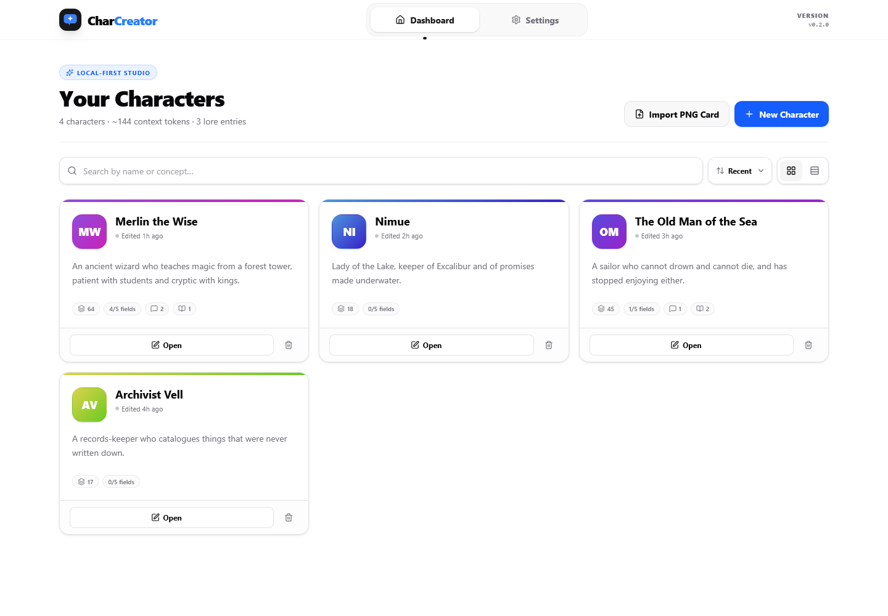

# Char Creator

A local-first character card studio for roleplay: build structured character
sheets with AI assistance, store everything in the browser, and export
spec-compliant Character Card V2/V3 PNGs.



## Features

- **AI-assisted authoring** — generate a whole sheet from a concept, or refine a
  single field, using OpenRouter (default), OpenAI, DeepSeek, Groq, Together, or
  any OpenAI-compatible endpoint.
- **Enhance and regenerate** — every field has both buttons. *Enhance* rewrites
  what is there; *Regenerate* writes it from scratch without sending the old
  draft, so a weak first attempt cannot anchor the next one. Each rewrite is
  undoable, and both prompts are editable in **Settings → Advanced**.
- **Local-first storage** — characters, avatars and media assets live in
  IndexedDB via Dexie. No account, no server-side database.
- **Structured cards** — main prompt, description, personality, scenario,
  backstory, related characters, multiple greetings, dialogue examples, an
  embedded lorebook, and an external world-info reference.
- **Lossless round-trips** — importing a card keeps every spec field this app
  does not edit (`tags`, `creator`, `creator_notes`, `system_prompt`,
  `post_history_instructions`, unknown lorebook keys, …) and writes them back on
  export.
- **PNG card export** — embeds `ccv3` and `chara` metadata directly into the
  image, with v2/v3 output selectable in settings.
- **Offline support** — a service worker keeps the app usable without a network.

## Tech stack

- [SvelteKit](https://kit.svelte.dev/) 2 + Svelte 5 (runes)
- [Tailwind CSS](https://tailwindcss.com/) v4
- [Dexie.js](https://dexie.org/) for IndexedDB
- [OpenAI SDK](https://github.com/openai/openai-node) for provider calls
- [Lucide](https://lucide.dev/) icons

## Getting started

```bash
npm install
npm run dev
```

Then open the app, go to **Settings**, and paste an API key for your provider.
OpenRouter is the default; local servers (Ollama, LM Studio) work through the
**Custom / Local API** provider.

```bash
npm run check     # svelte-check (types + a11y)
npm test          # unit tests (node:test, Node 22+)
npm run build     # production build
npm run preview   # serve the build
```

The tests cover the pieces most likely to break silently: PNG card-metadata
chunk handling (`tests/png.test.ts`), card spec mapping and round-trip fidelity
(`tests/card.test.ts`), reasoning-tag stripping (`tests/reasoning.test.ts`),
prompt-template rendering (`tests/prompts.test.ts`), and the dashboard's
formatting helpers (`tests/format.test.ts`).

> On Windows, `npm test` may fail with `spawn EPERM` when the runner is sandboxed
> (Node spawns one child per test file). Running a file directly —
> `node tests/card.test.ts` — exercises the same assertions.

### Browser tests

`tests/browser.test.mjs` drives the editor in a real browser with
`/api/generate` intercepted, so no model is called and no API key is needed. It
asserts the things unit tests cannot reach: that clicking **Regenerate** sends a
prompt without the stale draft, that **Enhance** does send it, that **Undo**
restores the previous text, and that a custom template from settings actually
reaches the request.

```bash
npm run dev            # terminal 1
npm run test:browser   # terminal 2
```

Playwright is optional. If it or a browser build is missing, the script prints a
skip notice and exits 0, so CI without browsers stays green.

## Configuration

The `/api/generate` and `/api/models` routes proxy provider calls so the browser
never has to deal with CORS. They are deliberately restricted:

| Variable | Effect |
| --- | --- |
| `CHAR_CREATOR_ALLOW_CUSTOM_PROVIDER=1` | Enables the custom provider (arbitrary base URL) on a public deployment. |
| `CHAR_CREATOR_ALLOWED_HOSTS` | Comma-separated hostnames the custom provider may reach. Takes precedence over the flag above. |

Both are unset by default. Outside production (`npm run dev`, `npm run preview`)
the custom provider is enabled automatically so local inference servers work.
See `.env.example`.

> **Why the restriction?** Without it, a deployed instance is an open relay:
> anyone could POST `{ provider: "custom", customBaseUrl: "http://169.254.169.254/..." }`
> and use your server to reach its own private network.

## Data and backups

Everything is local to the browser profile. **Settings → Database** exports a
JSON backup containing characters, images and assets.

- The backup deliberately **excludes the API key** — the file is plain JSON that
  people copy around.
- Importing a backup never applies a key from the file, and asks before changing
  the provider or base URL, so a shared backup cannot redirect your prompts.

## Card compatibility

Exports follow the Character Card V2/V3 spec. Fields the editor does not expose
are preserved through `data.cardMeta`, so importing and re-exporting a card from
another tool does not strip its metadata.

## Project layout

```
src/
  lib/
    card.ts              # spec mapping, field preservation, dialogue parsing
    db.ts                # Dexie schema + migrations
    format.ts            # dashboard formatting helpers (tokens, dates, initials)
    png.ts               # PNG chunk read/write, image compression, thumbnails
    prompts.ts           # editable enhance/regenerate templates + rendering
    settings.svelte.ts   # localStorage-backed settings store
    server/providers.ts  # provider allowlist / endpoint resolution
    components/
      dashboard/         # character card (grid + list)
      editor/            # editor sub-panels, AiFieldActions
      settings/          # prompt template editor
  routes/
    +page.svelte         # dashboard: search, sort, grid/list, import
    editor/[id]/         # character editor
    settings/            # AI, appearance, prompts, backup/restore
    api/generate/        # completion proxy
    api/models/          # model list proxy
  service-worker.ts      # offline cache
tests/                   # node:test unit tests (no browser required)
```
